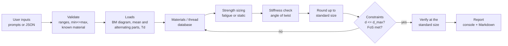

# Project walkthrough: design of machine elements by code

This document explains what the program does, why each step is there, and how to
demonstrate it. Read it top to bottom once. After that, use the **Demo script**
and **Viva questions** sections to prepare for the evaluation.

---

## 1. What the assignment asks and what this project gives you

The assignment says *choose any one* of three coding problems. All three are
built here, sharing one materials database, so you can present whichever topic
your group picked.

| Assignment requirement | Where it is in the code |
|---|---|
| Code in C/C++/Python | Python 3.10+, standard library only (no installs needed) |
| User provides the inputs during the demo | Interactive prompts, `mdesign/cli.py`. Every prompt has a default, so you can press Enter or type new values |
| **Coding 1** shaft: fluctuating torque, fluctuating BM, FoS, shaft configuration | `mdesign/shaft.py` |
| **Coding 2** rigid flanged coupling: torque input, all dimensions as output | `mdesign/coupling.py` |
| **Coding 3** bolted joint: fluctuating axial or shear load, standard bolt as output | `mdesign/bolted_joint.py` |
| Materials database with all properties, designer chooses a material | `mdesign/data/materials.json`. Pick a material yourself or let the program choose (`auto`) |
| ISO metric thread database | `mdesign/data/iso_metric_threads.json` plus `bolt_classes.json` (ISO 898-1 property classes) |
| Constraints: maximum shaft diameter and maximum angle of twist | Checked in Coding 1 and 2. A material that breaks a constraint is rejected |
| Output: standard sizes | Results are rounded up to standard shaft diameters, IS 2048 keys, ISO bolt sizes and ISO bolt lengths |

---

## 2. Running it

```bash
python main.py
```
That opens the menu. You can also start one design directly:

```bash
python main.py shaft
```

```bash
python main.py coupling
```

```bash
python main.py bolt
```

Run a saved input file without prompts and save the report:

```bash
python main.py --input examples/shaft_beam.json --report reports/shaft.md
```

Show the databases:

```bash
python main.py materials
```

```bash
python main.py threads
```

```bash
python main.py classes
```

Run the validation tests:

```bash
python -m unittest discover -s tests -v
```

Use `python3` instead of `python` on Linux/macOS if `python` is not found.

---

## 3. Project layout

```
main.py                     entry point (menu / command line)
mdesign/
  data/
    materials.json          18 materials: steels (IS + AISI), cast irons, aluminium
    iso_metric_threads.json ISO 261 coarse + fine threads, nut/washer/across-flats sizes
    bolt_classes.json       ISO 898-1 property classes 4.6 ... 12.9
    standards.json          standard shaft diameters, IS 2048 keys, key & bolt lengths
  database.py               loads the JSON files, unit conversion, look-ups, rounding to standard
  fatigue.py                Marin factors, notch sensitivity, Goodman/Soderberg/Gerber/ASME, DE equations
  shaft.py                  CODING 1
  coupling.py               CODING 2
  bolted_joint.py           CODING 3
  report.py                 calculation-sheet builder (console text + Markdown file)
  ui.py                     prompts with defaults and input checking
  cli.py                    menus, JSON input files, saving reports
examples/                   ready-made input files (one per scenario)
tests/test_designs.py       21 tests, including textbook cross-checks
docs/sample_reports/        reports produced from the example files
```

**Design rule used throughout:** the engineering code (`shaft.py`, `coupling.py`,
`bolted_joint.py`) never asks the user anything. It takes an input object and
returns a result plus a report. The prompts live only in `cli.py`. That is why
the same design can run interactively, from a JSON file, or inside a test.

---

## 4. The end-to-end pipeline (same idea for all three)



1. **Input.** Typed at prompts or read from a JSON file into an input object (`ShaftInput`, `CouplingInput`, `BoltInput`).
2. **Validation.** Bad input stops the run with a clear message: Mmin > Mmax, an unknown material, a cast-iron shaft, and so on.
3. **Loads.** The raw inputs become design loads: the bending-moment diagram, mean and alternating components, design torque, or load per bolt.
4. **Database.** Material properties (Sut, Syt, E, G, density, cost) or thread geometry are fetched from the JSON databases.
5. **Strength sizing.** Solve for the size that gives exactly the required factor of safety.
6. **Stiffness sizing.** Solve for the size that keeps the angle of twist within the limit.
7. **Standardisation.** Take the larger requirement and round **up** to the next standard size.
8. **Constraints.** If the standard size exceeds the maximum diameter, the material fails. In `auto` mode the loop goes back to step 4 with the next material.
9. **Verification.** Recompute every stress and factor of safety at the final standard size. Each check is printed as `[ OK ]` or `[FAIL]`.
10. **Output.** A final table of standard sizes, saved as Markdown if you want a report to submit.

---

## 5. Coding 1: power transmission shaft (fluctuating loads)

### 5.1 Inputs

| Input | Meaning |
|---|---|
| Shaft configuration | Either *beam* (bearing span, plus each gear/pulley position with vertical and horizontal force components, each varying min..max) or *direct* (you give Mmax and Mmin) |
| Bending cycle | *Rotating*: a rotating shaft under stationary loads, so bending is fully reversed. *Given*: use Mmax/Mmin as the cycle |
| Tmax, Tmin | Fluctuating torque (or power + speed + % fluctuation) |
| FoS, criterion | Required factor of safety; Goodman, Soderberg, Gerber or ASME-elliptic |
| Surface, reliability, temperature, notch | Endurance-limit modifiers and stress concentration |
| d_max, twist length, allowable twist | The two constraints from the assignment |
| Material | An id from the database, or `auto` |

### 5.2 Step by step

**Step 1: bending moment.** In beam mode the shaft is simply supported at A (x = 0)
and B (x = span). For each plane:

```
RB = sum(F_i x_i) / span          RA = sum(F_i) - RB
M(x) = RA x + RB (x - span)[if x > span] - sum F_i (x - x_i)[for loads left of x]
M_resultant = sqrt(Mv^2 + Mh^2)
```
The section with the largest resultant moment is the critical section. The
min-load-case moment is projected onto the max-case direction, so a load that
reverses is handled correctly.

**Step 2: mean and alternating components.**
```
Mm = (Mmax + Mmin)/2   Ma = (Mmax - Mmin)/2     (or Mm = 0, Ma = Mmax for a rotating shaft)
Tm = (Tmax + Tmin)/2   Ta = (Tmax - Tmin)/2
```
*Why the rotating option exists:* a point on a rotating shaft passes through the
tension side and the compression side once per revolution. A steady gear force
therefore produces **completely reversed** bending stress. This is the usual
case for gear and pulley shafts, and the beam-mode default.

**Step 3: material.** With `auto`, every shaft material is run through steps 4–9
and ranked by `relative cost x mass per metre`. The cheapest one that satisfies
every constraint wins. This is the "designer has access to the materials
database and chooses a suitable material" requirement.

**Step 4: endurance limit (Marin equation).**
```
Se = ka kb kc kd ke Se'      Se' = 0.5 Sut (Sut <= 1400 MPa)
ka = a Sut^b  (surface)       kb = 1.24 d^-0.107 (d <= 51 mm), 1.51 d^-0.157 (51-254 mm)
kc = 1 (von Mises handles combined loading)    kd = temperature    ke = reliability
```

**Step 5: stress concentration.** Kt and Kts come from the chosen notch
(shoulder fillet, keyseat, ...). Notch sensitivity uses Neuber's equation:
`q = 1/(1 + sqrt(a)/sqrt(r))`, `Kf = 1 + q(Kt - 1)`.

**Step 6: fatigue diameter (distortion energy + chosen criterion).** For Goodman:
```
A = sqrt(4(Kf Ma)^2 + 3(Kfs Ta)^2)     B = sqrt(4(Kf Mm)^2 + 3(Kfs Tm)^2)
d = [ (16 n / pi) (A/Se + B/Sut) ]^(1/3)
```
**Iteration:** kb and Kf both depend on d, which is unknown. The program starts
with kb = 1 and Kf = Kt, computes d, updates kb and Kf, and repeats until d
changes by less than 0.001 mm. It usually converges in 3–4 iterations, and the
report prints the table.

**Step 7: first-cycle yield.** `sigma'_max = (16/(pi d^3)) sqrt(4(Kf Mmax)^2 + 3(Kfs Tmax)^2) <= Syt/n`

**Step 8: angle of twist.** `theta = T L / (G J)`, so `d = [32 T L / (pi G theta_allow)]^(1/4)`

**Step 9: standard size.** `d_req = max(d_fatigue, d_yield, d_twist)`, rounded up to the
standard series (… 40, 45, 50, 55, 60, 70, 80 …) and checked against d_max.

**Step 10: verification.** Every stress and factor of safety is recomputed at the
standard diameter and printed as pass/fail.

### 5.3 Worked example (`examples/shaft_beam.json`)

Bearings 600 mm apart. A gear at 150 mm has radial 485–1456 N and tangential
1333–4000 N; a pulley at 450 mm has 1500–4500 N. Torque varies 200–600 N·m.
FoS 2, Goodman, d_max = 60 mm, twist ≤ 1° per metre, material `auto`.

* Critical section: x = 450 mm (pulley), M = 580.6 N·m, fully reversed.
* Tm = 400 N·m, Ta = 200 N·m.
* Fatigue d converges to 48.45 mm (kb 0.819, Kf 1.61, Se 200 MPa); twist needs 45.8 mm; yield needs less.
* Standard shaft: **50 mm, AISI 1060 / 60C4**. Fatigue FoS 2.19, yield FoS 3.78, twist 0.71°.
  1045-CD has the same cost index; the tie goes to the material with the higher factor of safety.

Full report: `docs/sample_reports/shaft_beam.md`.

---

## 6. Coding 2: rigid flanged coupling (static)

### 6.1 Steps and formulas

| Step | What is done | Formula |
|---|---|---|
| 1 | Design torque | `Td = Ks x T`, with `T = 60x10^6 P/(2 pi n)` N·mm if power is given |
| 2 | Permissible stresses | Ductile: `tau = 0.5 Syt/n` (max. shear stress theory), `sigma_c = Syt/n`. Cast iron: `tau = 0.5 Sut/n_flange`. Or type your own values |
| 3 | Shaft | Strength `d = (16 Td/(pi tau))^(1/3)`, twist `d = (32 Td L/(pi G theta))^(1/4)`, then standard size and d_max check |
| 4 | Hub | `D = 2d`, check as hollow shaft `tau = 16 Td D / (pi (D^4 - d^4))` |
| 5 | Key | `b x h` from IS 2048 table, length from shear `2Td/(d b tau)` and crushing `4Td/(d h sigma_c)`, at least `1.5d`, then the next standard key length. Hub length = key length |
| 6 | Flange | `D1 = 3d` (bolt PCD), `D2 = 4d` (OD), `t = 0.5d`, rim `t1 = 0.25d`, check `tau = 2Td/(pi D^2 t)` |
| 7 | Bolts | `N` = 3 (d ≤ 40), 4 (≤ 100), 6 (≤ 180). Shear `d1 = sqrt(8Td/(pi tau N D1))`, next ISO size (min. M6), crushing `2Td/(N d1 t D1)`, room for bolt heads, bolt length `2t + washer + nut + 2P` |

Proportions follow Bhandari's protective-type rigid flange coupling.

### 6.2 Worked examples

**Textbook check (`examples/coupling_textbook.json`).** 15 kW at 900 rpm, Ks = 1.35,
tau = 40 MPa, sigma_c = 80 MPa, tau(CI) = 8 MPa.
The program gives Td = 214.9 N·m and d = 30.1 mm, so **35 mm**. Hub is 70 mm, key
10 × 8 × 56, D1 = 105, D2 = 140, bolts 6.59 mm, so **3 × M8**. This matches the
standard textbook solution.

**Material-based design (`examples/coupling.json`).** 1000 N·m, Ks 1.25, FoS 3,
twist ≤ 1°/m, d_max 80. Every steel needs 55.1 mm for twist, because all steels
have the same modulus of rigidity G. A stronger steel therefore **does not help**,
and the cheapest steel (1020-HR) is selected at d = 60 mm. This is a good point
to make in the viva.

---

## 7. Coding 3: bolted joint under fluctuating load

### 7.1 Axial (tension) joint: why preload matters

A bolted joint is a spring system. The bolt (stiffness `kb`) is stretched by the
preload `Fi`; the plates (stiffness `km`) are compressed by the same amount. When
an external load `P` is applied, only the fraction `C = kb/(kb + km)` reaches the
bolt. The rest just reduces the plate compression. So the bolt sees a small
alternating stress on top of a high, steady preload, which is why preloaded bolts
survive fatigue.

| Step | Formula |
|---|---|
| Load per bolt | `P = P_total / N` |
| Thread geometry | `d2 = d - 0.6495P`, `d3 = d - 1.2269P`, `At = (pi/4)((d2+d3)/2)^2` (ISO 724 / 898) |
| Bolt length | `L >= grip + washer + nut height + 2P`, rounded up to an ISO length. Thread length `LT = 2d + 6` (L ≤ 125) |
| Bolt stiffness | `kb = Ad At E / (Ad lt + At ld)` |
| Member stiffness | 30° frustum: `km = 0.5774 pi E d / (2 ln[5(0.5774 l + 0.5d)/(0.5774 l + 2.5d)])` |
| Preload | `Fi = 0.75 Sp At` (reusable) or `0.90 Sp At` (permanent). Torque `T = K Fi d` |
| Stresses | `sigma_i = Fi/At`, `sigma_a = C(Pmax - Pmin)/(2At)`, `sigma_m = sigma_i + C(Pmax + Pmin)/(2At)` |
| Fatigue (Goodman) | `n_f = Se(Sut - sigma_i) / (Sut sigma_a + Se(sigma_m - sigma_i))` |
| Yield / proof | `n_p = Sp At / (C Pmax + Fi)` must be ≥ 1 |
| Load factor | `n_L = (Sp At - Fi) / (C Pmax)` |
| Separation | `n_0 = Fi / (Pmax (1 - C))` |

**Selection loop:** for each ISO 898-1 class (4.6 … 12.9), sizes are tried from the
smallest up. The first size that meets every requirement (n_f, n_L, n_0 ≥ FoS and
n_p ≥ 1) is that class's answer. Among those, the lowest cost index
(class cost × d² × L) is chosen. You can also fix the class or the size, for
example to show that M6 fails.

### 7.2 Shear joint

* **Friction-grip (slip-critical):** `slip resistance = N mu m Fi ≥ FoS x Pmax`. The plates' friction carries the load, so the bolt stress stays at the preload and there is no fatigue.
* **Bearing type:** the shank carries shear. `tau = P/(N m A)`, then `tau_a`, `tau_m` and von Mises `sqrt(3) tau`, then Goodman. Static shear uses `0.577 Sp / tau_max`, and bearing on the bolt and on the plate uses `P/(N d t)`.

### 7.3 Worked example (`examples/bolt_axial.json`)

Cylinder cover with 8 bolts, gas load 30–120 kN, 40 mm steel grip, FoS 2.
Per bolt: 3.75–15 kN. The class table shows 4.6/4.8/5.8 need M16, while 8.8 and
10.9 need M10 and 12.9 needs M8. Cheapest: **8 × ISO 4014 M10 × 1.5 × 55, class 8.8**.
Working: C = 0.168, Fi = 25.2 kN, sigma_a = 16.3 MPa,
n_f = 2.84, n_L = 3.33, n_0 = 2.02, tightening torque ≈ 50 N·m.

---

## 8. The databases

* **materials.json**: Sut, Syt, E, G, density, elongation, BHN, relative cost and allowed uses (shaft, key, bolt, flange, member). Steel values are typical minimums from Shigley Tables A-20/A-21, with the nearest IS 1570 designation (20C8, 30C8, 40C8, 45C8 …). Cast irons follow IS 210 / IS 1865. **Check the values against your course data book**; edit the JSON to match it and the whole program follows.
* **iso_metric_threads.json**: d, coarse and fine pitch, first-choice flag, ISO 4032 nut height, across-flats, ISO 7089 washer thickness. Pitch/minor diameters and stress areas are *computed* from d and P with the ISO profile formulas, so they cannot be mistyped.
* **bolt_classes.json**: ISO 898-1 Sp, Sut, Sy, plus the fully corrected endurance strength Se (Shigley Table 8-17). For 4.6/4.8/5.8, Se is estimated as `0.5 Sut ka kc / Kf` with Kf = 2.2.
* **standards.json**: standard shaft sizes (Bhandari), IS 2048 parallel keys, key lengths, ISO bolt lengths.

To add a material, copy one block in `materials.json`, change the values, and give
it a new `id`. Nothing else needs to change.

---

## 9. How we know the answers are right (validation)

`python -m unittest discover -s tests -v` runs 21 tests, including:

| Check | Published value | Program |
|---|---|---|
| Shigley Ex. 7-1, DE-Goodman FoS | 1.62 | 1.62 |
| Shigley Ex. 7-1, DE-Gerber / ASME / Soderberg | 1.87 / 1.88 / 1.56 | 1.86 / 1.87 / 1.56 |
| Shigley Ex. 7-1, Se | 29.3 kpsi | 29.2 kpsi |
| ISO stress area M8 / M12 / M16 / M24 | 36.6 / 84.3 / 157 / 353 mm² | same (±1 %) |
| Textbook flange coupling (15 kW, 900 rpm) | d = 35 mm, 3 × M8 | d = 35 mm, 3 × M8 |
| Beam: central load, overhang, two-plane loads | PL/4, F·a, resultant | exact |
| DE closed-form d gives back the target FoS (all 4 criteria) | n = 2 | n = 2.000000 |
| Selected bolt is the smallest that passes | — | smaller sizes all fail |

---

## 10. Demo script for the evaluation (about 5 minutes)

1. `python main.py` and pick **4** to show the materials database. Then pick the topic number.
2. Press **Enter** through the prompts once. Explain each group as it appears: configuration, torque, design factors, constraints, material.
3. Point out in the output:
   * the bending-moment table and the critical section (Coding 1)
   * the **material comparison table**, showing which materials fail the d_max constraint
   * the **iteration table** for kb and Kf (Coding 1), or the **class/size table** (Coding 3)
   * the `[ OK ]` checks and the **FINAL OUTPUT** with standard sizes
4. Then let the examiner type new values. Good "what if" runs:
   * **Coding 1:** set d_max = 45, so no material is feasible and the program says so. Set the twist limit to 0.25° and d_max to 80: twist now governs, the shaft grows to 70 mm, and the cheapest steel wins because extra strength no longer helps. Choose `1020-HR` instead of `auto` to get a 60 mm shaft.
   * **Coding 2:** answer "yes" to own permissible stresses and type a textbook problem's values.
   * **Coding 3:** type `M8` as the bolt size and `8.8` as the class to see it fail. Then switch to `auto`. Try the shear load with the friction-grip option.
5. Save the report (Markdown) when asked. That file can go straight into your submission.

---

## 11. Likely viva questions

* **Why is bending fully reversed on a rotating shaft?** Each fibre moves from the tension side to the compression side every revolution, even under a steady load.
* **Why iterate for the shaft diameter?** The size factor kb and the notch sensitivity q depend on d, which is what we are solving for.
* **Goodman vs Soderberg vs Gerber?** Soderberg (line to Syt) is the most conservative. Goodman (line to Sut) is the usual design choice. Gerber (parabola) fits test data best. ASME-elliptic is used for shafts in the ASME code.
* **Why check twist separately?** Strength depends on Syt; twist depends only on G, which is almost the same for every steel. A stronger steel can't fix a twist problem, only a bigger diameter can.
* **Why round up to standard sizes?** So that bars, bearings, keys and fasteners can be bought off the shelf and are interchangeable.
* **Why does the bolt see only C × P?** The bolt and the clamped plates act as springs in parallel for the external load. The stiffer plates take most of it.
* **Why preload at 75 % of proof load?** High enough to keep the joint closed and reduce the bolt's alternating stress, low enough that the external load does not yield the bolt.
* **Why a higher FoS for a cast-iron flange?** Cast iron is brittle and has no yield point, so it fails suddenly. A larger margin (6) is customary.

---

## 12. Assumptions and limits

* Steels are treated as ductile, with von Mises (distortion-energy) stresses for combined loading. The coupling uses the maximum-shear-stress theory, as in the textbook.
* In beam mode, the stress raiser is assumed to sit at the section with the largest bending moment (conservative). For a real stepped shaft, check each shoulder and keyway section separately; the direct mode does exactly that.
* Shaft deflection, critical speed and bearing selection are outside the brief and are not computed.
* Bolt fatigue uses the tabulated Se for rolled threads; for a plain shank in shear this is conservative.
* Relative costs are illustrative. They only rank options, they are not prices.
